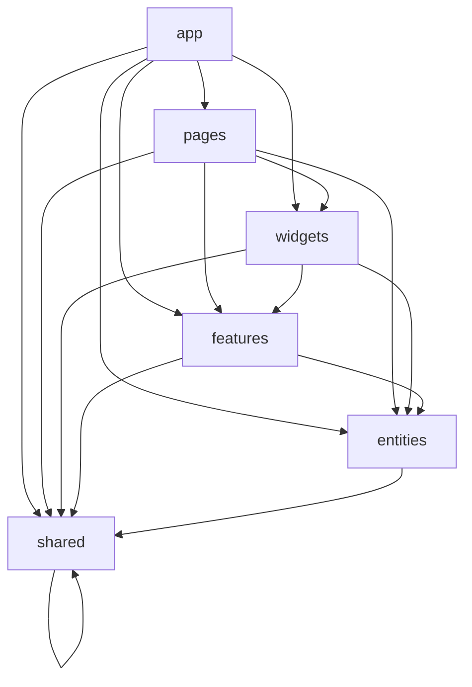

## Архітектура Feature-Sliced Design (FSD)

### Граф залежностей між шарами

Згідно з правилами FSD, імпорти дозволені виключно зверху вниз:

### Принципи ізоляції:
- **Public API:** кожен слайс (`entities/user`, `widgets/app-header` тощо) експортує назовні сутності виключно через свій кореневий `index.ts`. Глибокі імпорти (наприклад, з внутрішніх папок `ui` чи `model`) заборонені.
- **Заборона перехресних зв'язків:** модулі на одному рівні (наприклад, `features/auth` та `features/user-form`) не мають прямого доступу один до одного; взаємодія між ними оркеструється на рівні `widgets` або `pages`.

---

## Порівняння підходів збереження стану (State Persistence)

| Критерій | Ручне збереження (`localStorage.setItem`) | Плагін `pinia-plugin-persistedstate` |
| :--- | :--- | :--- |
| **Реалізація** | Імперативна: виклики `setItem`/`getItem` у кожному екшені | Декларативна: додавання властивості `{ persist: true }` у визначенні стору |
| **Кількість коду** | Багато шаблонного коду (boilerplate) | Мінімальна (1 рядок конфігурації) |
| **Контроль стану** | Повний контроль: можна фільтрувати окремі поля вручну | Зберігає стан автоматично; вибіркові поля потребують налаштування `paths` |
| **Синхронізація** | Ризик розсинхронізації, якщо пропустити виклик при зміні рефу | Автоматична підписка на будь-які реактивні мутації стору |